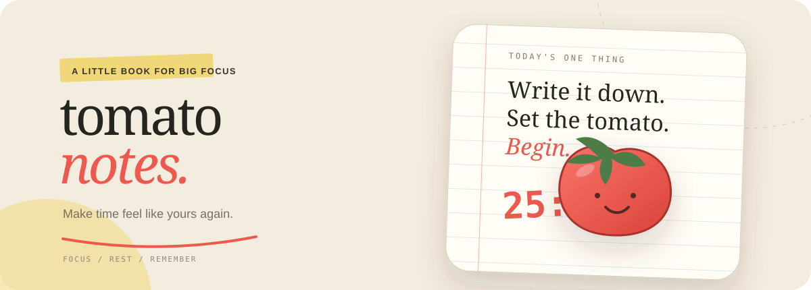

<div align="center">
  
</div>

<div align="center">
  <br />
  <a href="https://vercel.com/new/clone?repository-url=https://github.com/sidnim12/tomato-notes"></a>
  
  
  
</div>

<br />

> A login-free Pomodoro notebook for focused work and honest reflection. Name one task, focus with a friendly tomato, take a real break, and keep a private record of your rhythm.

## Focus edition

This branch is the complete public edition of Tomato Notes. It requires no account, Supabase project, email provider, API key, or paid service. Every visitor gets the full Focus, Journal, Rhythm, About, and issue-reporting experience immediately.

Focus records are stored in the browser on the visitor's device. Closing and reopening the browser preserves them. Clearing the site's browser data, using private browsing, or changing devices/browsers creates a separate notebook.

<div align="center">
  
</div>

## Highlights

- Animated editorial landing page and dedicated Pomodoro guide
- Configurable 15–50 minute focus timer
- Automatic five-minute short breaks
- Automatic fifteen-minute long break after every four completed focus rounds
- Persistent cycle position, Journal entries, and weekly Rhythm history
- Honest tracking for completed and interrupted sessions
- Full Journal and Recharts-powered seven-day Rhythm view
- Light and dark themes with responsive mobile layouts
- Notebook-inspired navigation, page transitions, cursor details, and tomato artwork
- Public GitHub issue workflow for reports and feature requests
- No login, environment variables, database, or email quota
- Vercel-ready production configuration

## Technology

| Layer | Technology |
| --- | --- |
| Interface | React |
| Build system | Vite |
| Animation | Framer Motion |
| Charts | Recharts |
| Icons | Lucide React |
| Persistence | Browser localStorage |
| Hosting | Vercel |

## Run locally

Requires Node.js 20 or newer and npm.

```bash
git clone https://github.com/sidnim12/tomato-notes.git
cd tomato-notes
npm install
npm run dev
```

Open [http://localhost:5173](http://localhost:5173).

## Production build

```bash
npm run build
npm run preview
```

Vite writes the optimized site to `dist/`.

## Deploy with Vercel

Import this repository from the [Vercel dashboard](https://vercel.com/new) and use:

| Setting | Value |
| --- | --- |
| Framework preset | `Vite` |
| Root directory | `./` |
| Install command | `npm install` |
| Build command | `npm run build` |
| Output directory | `dist` |

No environment variables are required for the Focus edition. The included `vercel.json` supports the single-page application on direct navigation.

## How persistence works

- Completed and interrupted focus records are saved under a browser-local key.
- The current four-round Pomodoro cycle is saved separately.
- The Journal shows today's records while Rhythm reads the rolling seven-day history.
- Data survives tabs, browser restarts, and device restarts on the same browser profile.
- Data does not sync between devices. Export, accounts, and optional cloud sync can be developed later without blocking this edition.

## Project structure

```text
tomato-notes/
├── docs/                  README artwork
├── public/                favicon and static files
├── src/
│   ├── App.jsx            application, timer, pages and persistence
│   ├── main.jsx           React entry point
│   └── styles.css         themes, responsive layout and animation
├── index.html             document metadata and favicon
├── package.json           scripts and dependencies
└── vercel.json            Vercel routing configuration
```

## Issues and contributions

Use [GitHub Issues](https://github.com/sidnim12/tomato-notes/issues) to search existing reports, file a reproducible bug, or suggest a feature. Contributions are welcome through focused branches and pull requests.

## License

This repository is currently provided as a personal project. Add a license before redistributing it or using it commercially.

<div align="center">
  <br />
  <strong>One task. One tomato. One honest page.</strong>
  <br /><br />
  Made for quiet progress 🍅
</div>
