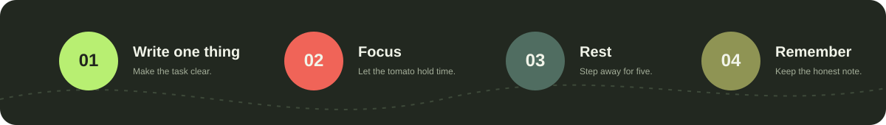

<div align="center">
  
</div>

<div align="center">
  <br />
  <a href="https://vercel.com/new/clone?repository-url=https://github.com/sidnim12/tomato-notes"></a>
  
  
  
</div>

<br />

> A gentle Pomodoro notebook for focused work and honest reflection. Choose one task, focus with a friendly tomato, take a real break, and keep a private record of your rhythm.

## The idea

Most productivity dashboards feel like spreadsheets wearing nicer clothes. Tomato Notes takes a different approach: a tactile, diary-inspired workspace with paper texture, expressive typography, real page transitions, and a timer that feels like a companion rather than a stopwatch.

The result combines the usefulness of a Pomodoro timer with the personality of a hand-kept focus journal.

<div align="center">
  
</div>

## Highlights

- **Animated landing experience** with scroll-triggered storytelling and editorial motion
- **Tomato focus timer** with configurable 15–50 minute sessions
- **Automatic break page** that turns the notebook page and begins a five-minute break
- **Honest session ledger** for completed and interrupted sessions
- **Daily fresh page** while previous records remain available for weekly calculations
- **Supabase authentication and cloud sync** protected with row-level security
- **Private issue reporting** visible only to approved developer accounts
- **Weekly rhythm chart** built with Recharts
- **Light and dark themes** with separate, carefully tuned accent systems
- **Notebook-style navigation** with functional Focus, Journal, and Rhythm tabs
- **Pomodoro guide and FAQ** presented as a dedicated editorial page
- **Minimal cursor trail** with responsive hover and click feedback
- **Responsive design** for desktop, tablet, and mobile
- **Reduced-motion support** for accessibility
- **Vercel-ready configuration** included in the repository

## Technology

| Layer | Technology |
| --- | --- |
| Interface | React |
| Build system | Vite |
| Animation | Framer Motion |
| Charts | Recharts |
| Icons | Lucide React |
| Authentication and database | Supabase Auth + PostgreSQL |
| Hosting | Vercel |

## Run locally

Requirements: Node.js 20 or newer and npm.

```bash
git clone https://github.com/sidnim12/tomato-notes.git
cd tomato-notes
npm install
npm run dev
```

Open [http://localhost:5173](http://localhost:5173).

## Configure Supabase

1. Create a Supabase project and open its SQL Editor.
2. Run [`supabase/schema.sql`](./supabase/schema.sql) to create the session table and row-level security policies.
3. Copy `.env.example` to `.env.local`.
4. Add your project URL and public anon key:

```env
VITE_SUPABASE_URL=https://YOUR_PROJECT.supabase.co
VITE_SUPABASE_ANON_KEY=YOUR_PUBLIC_ANON_KEY
```

Only use the public anon key in the frontend. Never expose a secret or service-role key.

After creating your own account, promote it to the private developer desk from the Supabase SQL Editor:

```sql
insert into public.developer_members (user_id)
select id from auth.users where email = 'YOUR_EMAIL';
```

Add teammates later by running the same query with their confirmed account email. Regular users can submit private reports but cannot list or read any reports. Approved developers can review reports, update their status, and open sanitized GitHub issues from the developer desk.

## Production build

```bash
npm run build
npm run preview
```

Vite writes the optimized production site to `dist/`.

## Deploy with Vercel

Import this repository from the [Vercel dashboard](https://vercel.com/new) and use:

| Setting | Value |
| --- | --- |
| Framework preset | `Vite` |
| Root directory | `./` |
| Install command | `npm install` |
| Build command | `npm run build` |
| Output directory | `dist` |

Add `VITE_SUPABASE_URL` and `VITE_SUPABASE_ANON_KEY` under **Project Settings → Environment Variables** before deploying.

The included [`vercel.json`](./vercel.json) sends application routes back to `index.html`, keeping the single-page experience compatible with direct navigation.

## How data is handled

Tomato Notes stores focus history in Supabase PostgreSQL. Email/password authentication identifies each user, and PostgreSQL row-level security ensures users can only access their own records.

- The Journal displays entries from the current day.
- The Rhythm view uses saved history for the rolling seven-day chart.
- Opening the app on a new day produces a clean daily page without deleting earlier history.
- Auth sessions persist securely through the Supabase client and work across devices.

## Project structure

```text
tomato-notes/
├── docs/                  README artwork
├── public/                favicon and static files
├── src/
│   ├── App.jsx            application, timer, pages and persistence
│   ├── main.jsx           React entry point
│   └── styles.css         themes, responsive layout and animation
├── index.html             document metadata and favicon
├── package.json           scripts and dependencies
└── vercel.json            Vercel routing configuration
```

## Privacy note

This project requires an account so focus history can sync across devices. The browser receives only the public Supabase anon key; database row-level security protects every user's records. Never expose a Supabase secret or service-role key in the frontend.

## Contributing

Ideas and improvements are welcome. Create a branch, make the change, verify `npm run build`, and open a pull request with a short description of the interaction or design decision.

## License

This repository is currently provided as a personal project. Add a license before redistributing or using it commercially.

<div align="center">
  <br />
  <strong>One task. One tomato. One honest page.</strong>
  <br /><br />
  Made for quiet progress 🍅
</div>
